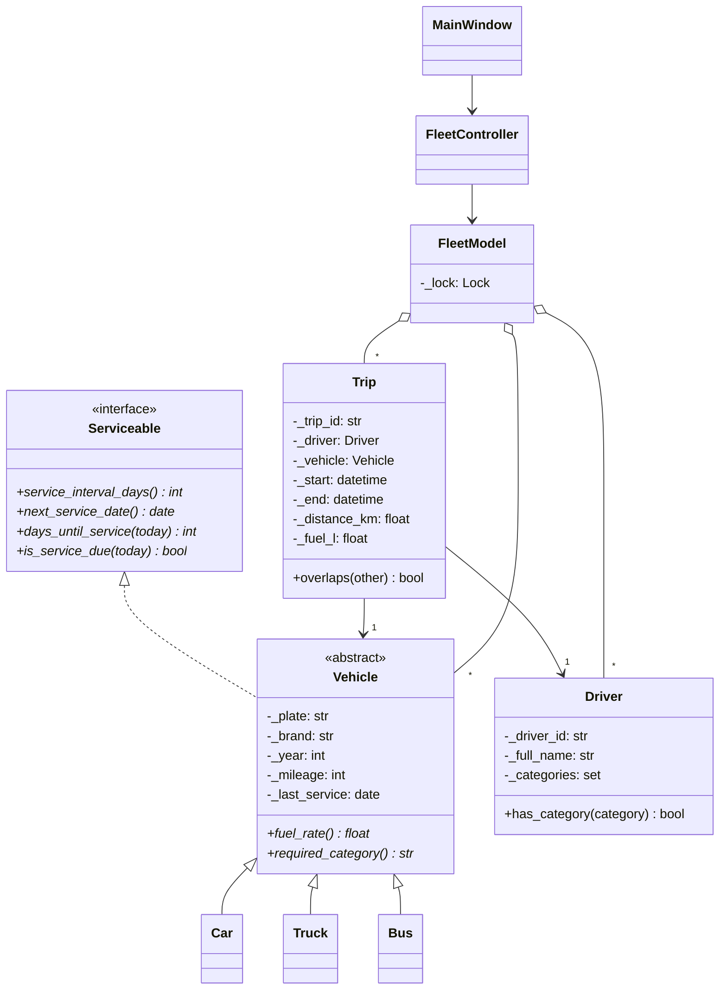

# DESIGN – ПЗ обліку автопарку

Робоча специфікація. Рішення ухвалює автор роботи, ШІ лише допомагав їх оформити.
Позначка `[ПРИПУЩЕННЯ]` – значення, яке запропонував ШІ і яке ще треба підтвердити або змінити.

## 1. Призначення

Настільний застосунок для обліку транспорту, водіїв і поїздок. Користувач один: диспетчер або
завгосп невеликої компанії з перевезення вантажів (у курсовій – сам автор).
Застосунок показує транспорт (тип, номер, марка, рік, пробіг, дата останнього ТО), водіїв і поїздки,
рахує пальне, терміни ТО, перевіряє конфлікти поїздок, імпортує та експортує дані.

Стек: Python 3.14, CustomTkinter, `ttk.Treeview`, `json`, `xml.etree.ElementTree`, `threading`,
`concurrent.futures`, `queue`, `logging`. IDE: PyCharm.

## 2. Рішення автора

| № | Питання | Рішення |
|---|---|---|
| 1 | Де розмістити `Serviceable` | Варіант А: `class Vehicle(Serviceable, ABC)`, кожен транспорт обслуговується |
| 2 | Конфлікт поїздок | Перевіряються водій і авто. Межі часу включно: кінець о 12:00 і початок о 12:00 – конфлікт |
| 3 | Пальне | За формулою: `fuel_rate() * distance_km / 100` |
| 4 | Термін ТО | За датою: дата останнього ТО + інтервал типу транспорту |

Обґрунтування рішення 1: `[ЗАПОВНИТИ своїми словами]`

## 3. Правила предметної області

**Конфлікт.** Дві поїздки конфліктують, якщо мають спільного водія або спільне авто і їхні проміжки
часу перетинаються: `a.start <= b.end and b.start <= a.end`. Під час редагування поїздка не порівнюється сама з собою.

**Параметри типів** `[ПРИПУЩЕННЯ – спрощені значення, не офіційні норми]`

| Клас | `fuel_rate()`, л/100 км | `service_interval_days()` | `required_category()` |
|---|---|---|---|
| `Car` | 8 | 365 | B |
| `Truck` | 28 | 180 | C |
| `Bus` | 22 | 120 | D |

**Поле пального в поїздці.** Завдання вимагає поле «пальне» у `Trip`. Воно заповнюється за формулою під час
створення поїздки і зберігається в JSON. `[ПРИПУЩЕННЯ]`

**Пробіг авто.** Поле `mileage` редагується вручну, поїздки його автоматично не змінюють. `[ПРИПУЩЕННЯ]`

**Валідація**

| Поле | Правило |
|---|---|
| Номер | 2 літери + 4 цифри + 2 літери, напр. `ВН1234АА`; унікальний |
| Рік | від 1950 до поточного + 1 `[ПРИПУЩЕННЯ]` |
| Пробіг | ціле число, не менше 0 |
| Категорії водія | лише зі списку: A1, A, B1, B, C1, C, D1, D, BE, C1E, CE, D1E, DE, T; хоча б одна |
| Поїздка | `end > start`, `distance_km > 0`, водій має `required_category()` авто |

## 4. Архітектура (MVC)

```text
fleet_app/
├── main.py            точка входу
├── models/            домен: без tkinter і без файлів
│   ├── serviceable.py Serviceable
│   ├── vehicle.py     Vehicle, Car, Truck, Bus
│   ├── driver.py      Driver
│   ├── trip.py        Trip
│   ├── exceptions.py  власні винятки
│   └── fleet.py       FleetModel: дані, CRUD, пошук, фільтр, сортування, Lock
├── services/          JSON, XML, паралельні розрахунки, перевірка конфліктів
├── controllers/       FleetController: дії користувача, запуск потоків, черга
├── views/             вікна й форми CustomTkinter, таблиці ttk.Treeview
├── tools/             генератор 10 000+ поїздок, вимірювання T1/Tn
├── data/              fleet.json, великий набір
├── logs/              журнал (не в архіві)
└── tests/
```

Залежності лише згори вниз: `views → controllers → services → models`. Модель нічого не знає про інтерфейс.

## 5. Формат даних

```json
{
  "vehicles": [
    {"type": "Truck", "plate": "ВН1234АА", "brand": "MAN", "year": 2019,
     "mileage": 182500, "last_service": "2026-05-14"}
  ],
  "drivers": [
    {"id": "D001", "full_name": "Петренко Іван Олегович", "categories": ["B", "C"]}
  ],
  "trips": [
    {"id": "T00001", "driver_id": "D001", "plate": "ВН1234АА",
     "start": "2026-10-01T08:00", "end": "2026-10-01T15:30",
     "distance_km": 320, "fuel_l": 89.6}
  ]
}
```

Звіт XML: період + для кожного авто сумарний кілометраж, пальне і кількість поїздок за період.

## 6. Багатопоточність

| Що | Як |
|---|---|
| Імпорт / експорт JSON, експорт XML | власний `threading.Thread`, інтерфейс не зависає |
| Розрахунок пального і термінів ТО | дані діляться на частини, кожна частина – задача в `ThreadPoolExecutor` |
| Зв’язок з інтерфейсом | потоки кладуть у `queue.Queue` повідомлення (прогрес / результат / помилка); `after(100, ...)` читає чергу в головному потоці; з потоків віджети не чіпаємо |
| Спільні дані | списки `FleetModel` і накопичені підсумки захищені `threading.Lock` |
| Індикатор | `CTkProgressBar` |
| Помилка в потоці | перехоплюється, пишеться в журнал, через чергу йде в інтерфейс як повідомлення |

Вимірювання: T1 і Tn по 3–5 запусків, S = T1/Tn. Розрахунки навантажують процесор, а Python 3.14 у стандартній
збірці має GIL, тому S може бути близьким до 1 або меншим. Це чесний результат, його треба пояснити, а не підганяти.

## 7. Вікна

Головне вікно з вкладками «Транспорт», «Водії», «Поїздки», «Розрахунки» та панеллю імпорту / експорту;
пошук, фільтр за типом, сортування кліком по заголовку; форми додавання й редагування; вибір періоду для XML.

## 8. Чернетка UML

Лише орієнтир. Фінальну діаграму для записки робимо з реального коду.


